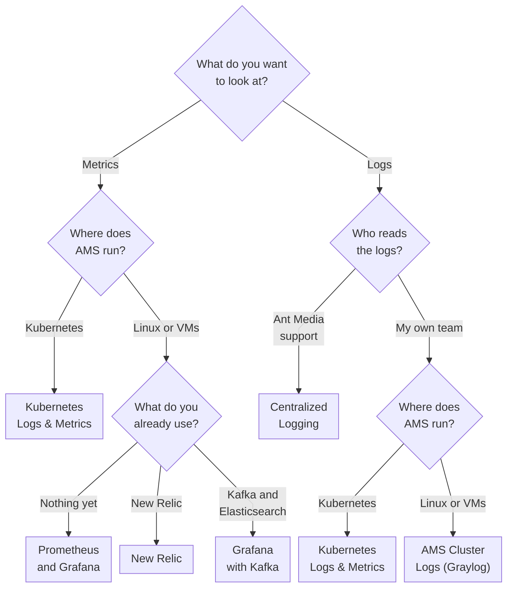

# Which Monitoring Option Should I Use?

Start by deciding what you want to look at. Monitoring options fall into two groups:

- **Metrics** are numbers that change over time, such as live streams, viewers, CPU and memory. You watch them on a dashboard to see how your servers are doing right now and over the past days.
- **Logs** are the text lines AMS writes while it runs, such as warnings, errors and connection events. You search them when something goes wrong and you need to find out why.

After that, the decision tree asks where AMS runs and what tools you already use.

- **[Prometheus and Grafana](/category/prometheus-and-grafana/):** the recommended starting point for metrics on Linux servers. AMS already publishes its metrics, so you only add Prometheus and Grafana. It works for a single server, a manual cluster, and an autoscaling cluster, where new nodes are found automatically. If you're not sure which metrics option to use, start here.
- **[New Relic](/guides/monitoring/monitor-ant-media-server-statistics-with-new-relic/):** sends AMS analytics events, such as streams started, viewers and watch time, to your New Relic account. New Relic hosts the dashboard, so you run no monitoring servers yourself. Choose it if your team already uses New Relic.
- **[Grafana with Kafka](/guides/monitoring/monitoring-ams-with-grafana/):** AMS sends its statistics to Apache Kafka, Logstash stores them in Elasticsearch, and Grafana shows them. Choose it if you already run Kafka and Elasticsearch. Otherwise, Prometheus and Grafana gives you the same kind of dashboard with far fewer services.
- **[Kubernetes Logs & Metrics](/guides/monitoring/loki-prometheus-setup/):** for AMS running on Kubernetes. It collects both logs, with Loki, and metrics, with Prometheus, and shows them in Grafana.
- **[AMS Cluster Logs with Graylog](/guides/monitoring/collecting-logs-from-ams-cluster/):** collects the logs of every AMS server into one self-hosted Graylog server, so your team can search them in one place. It needs a separate server with at least 4 GB RAM.
- **[Centralized Logging](/guides/monitoring/centralized-logging/):** sends AMS logs to Ant Media's logging platform, where the Ant Media support team can review them to help you troubleshoot. You don't run any logging servers yourself. Only operational log lines are sent, never video, audio or passwords.

## Compare the options

| Option | What you see | Where AMS runs | What you set up | Best for |
| --- | --- | --- | --- | --- |
| [Prometheus and Grafana](/category/prometheus-and-grafana/) | Metrics | Linux servers or VMs, standalone or cluster | Prometheus and Grafana, on the AMS server or a monitoring server | Most setups |
| [New Relic](/guides/monitoring/monitor-ant-media-server-statistics-with-new-relic/) | Analytics events | Linux servers or VMs | The New Relic agent on each AMS server, and a New Relic account | Teams that already use New Relic |
| [Grafana with Kafka](/guides/monitoring/monitoring-ams-with-grafana/) | Metrics | Linux servers or VMs | Kafka, Elasticsearch, Logstash and Grafana | Teams that already run Kafka and Elasticsearch |
| [Kubernetes Logs & Metrics](/guides/monitoring/loki-prometheus-setup/) | Metrics and logs | Kubernetes | Loki, Promtail, Prometheus and Grafana, installed with Helm | AMS on Kubernetes |
| [AMS Cluster Logs with Graylog](/guides/monitoring/collecting-logs-from-ams-cluster/) | Logs | Linux servers or VMs | Graylog, MongoDB and Elasticsearch on a server with 4 GB RAM or more | Searching the logs of many servers yourself |
| [Centralized Logging](/guides/monitoring/centralized-logging/) | Logs | Linux servers, VMs or Kubernetes | Fluent Bit on each AMS server, or as a DaemonSet on Kubernetes. Ant Media hosts the rest | Getting help from Ant Media support |

## Can I use more than one?

Yes. Metrics and logs answer different questions, so many teams use one of each. For example, use [Prometheus and Grafana](/category/prometheus-and-grafana/) to see that a server's CPU is high, and [AMS Cluster Logs with Graylog](/guides/monitoring/collecting-logs-from-ams-cluster/) or [Centralized Logging](/guides/monitoring/centralized-logging/) to find the errors that explain why.
